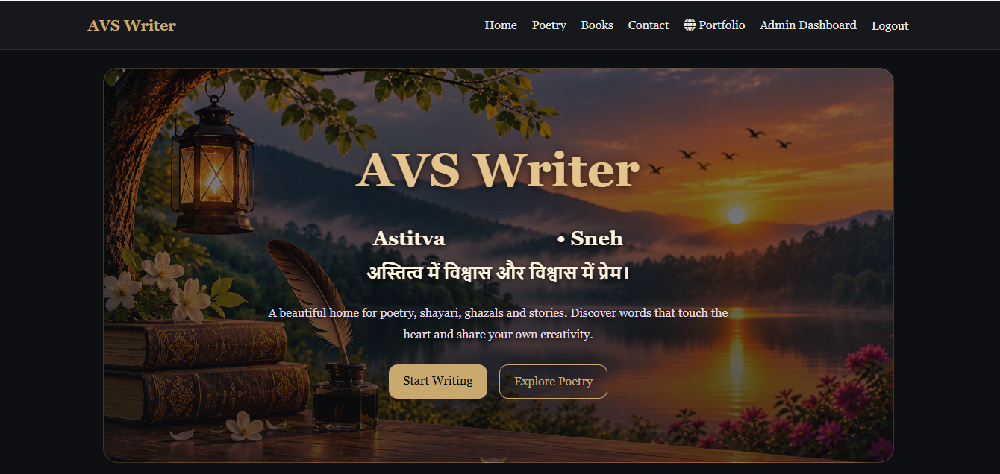
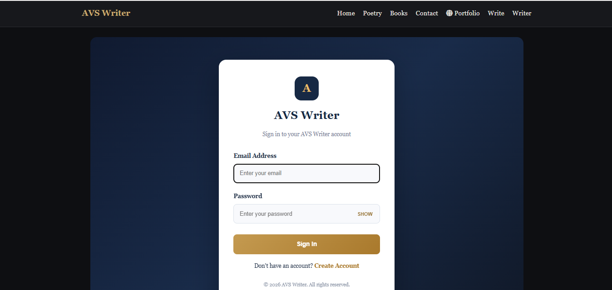
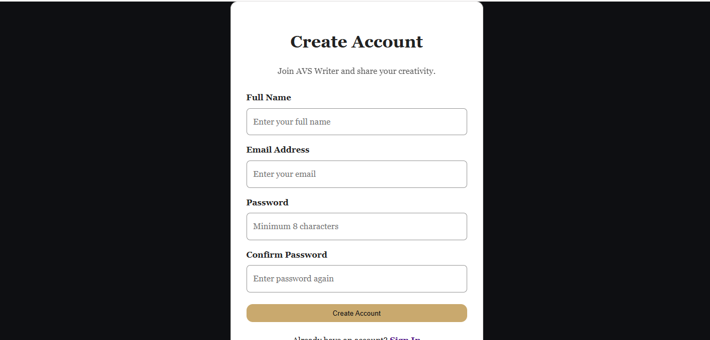
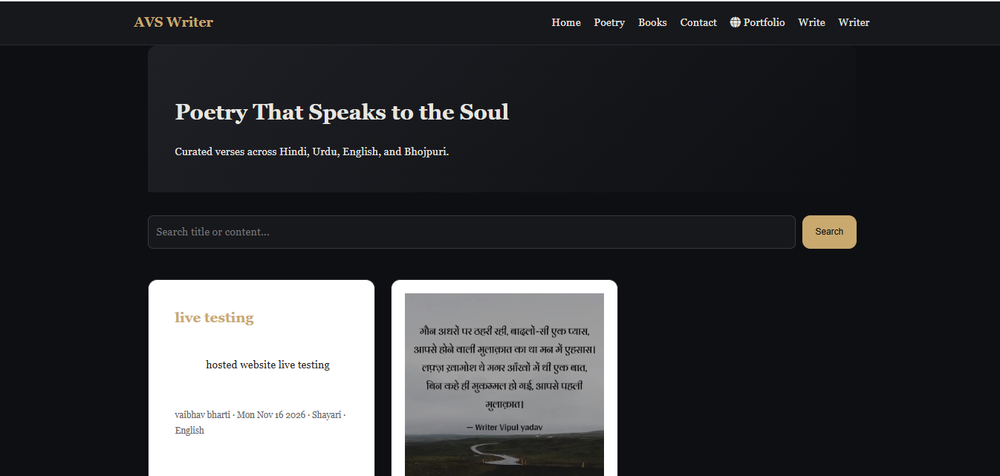
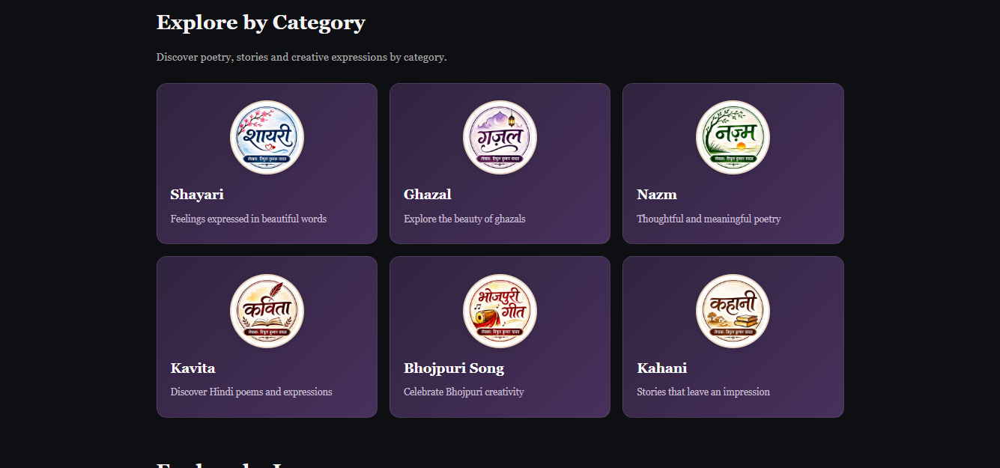
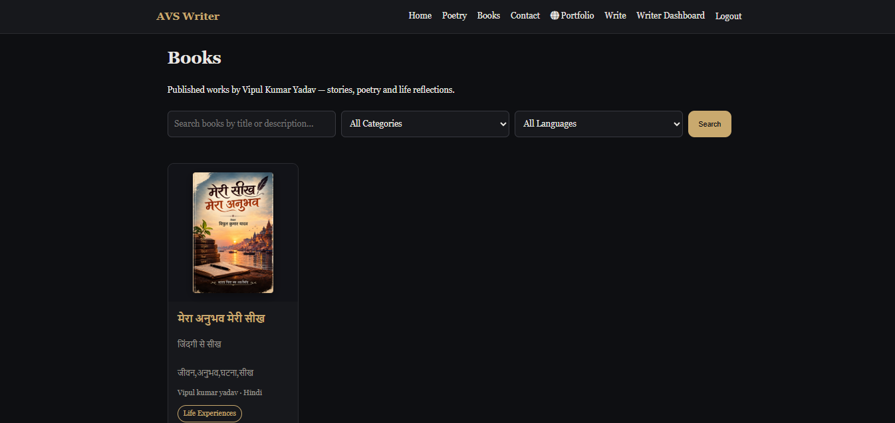
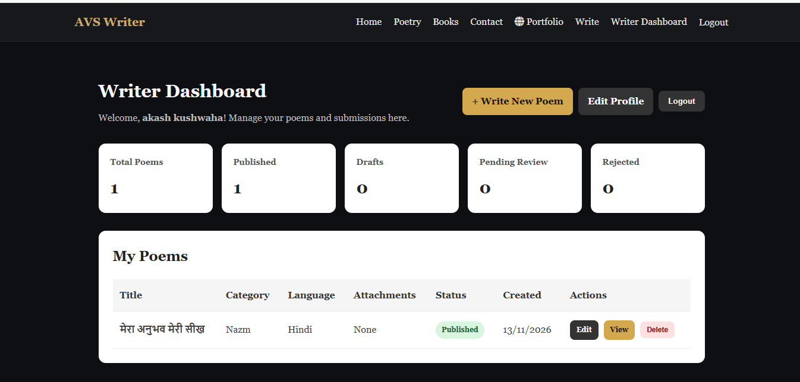
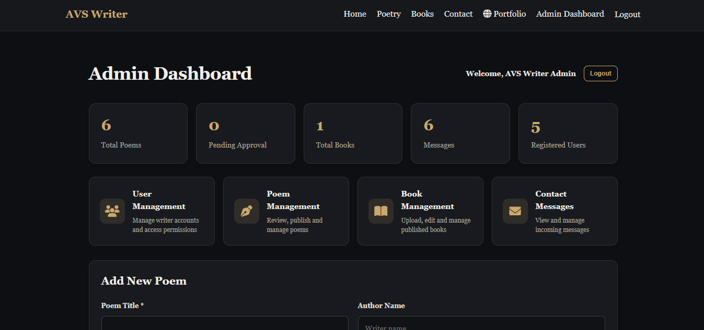
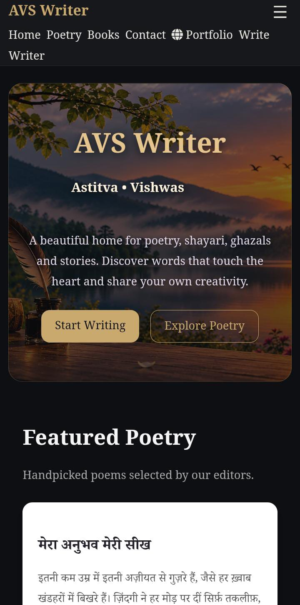
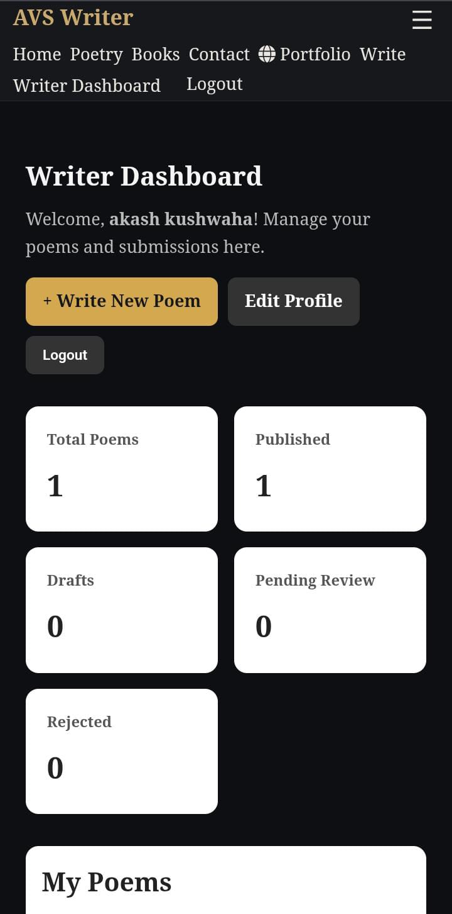

# AVS Writer

**A Platform for Poetry, Shayari, Ghazal & Literary Writing**

AVS Writer is a web-based literary platform designed for writers and readers to share, explore, and manage creative literary content. The platform supports poetry, shayari, ghazals, writer profiles, book collections, and literary contributions.

**Live Website:** https://avs-writer.onrender.com

## Features

- **User Authentication:** Secure user registration and login.
- **Role-Based Access Control:** Separate permissions for Writers and Administrators.
- **Writer Dashboard:** Manage writing contributions and profile information.
- **Literary Content:** Explore poetry, shayari, ghazals, and other creative works.
- **Writer Profiles:** Public author profiles and profile photo uploads.
- **Writing Management:** Create and manage literary submissions.
- **File Uploads:** Support for permitted image and PDF attachments.
- **Book Management:** Book listings, cover images, and PDF documents.
- **Admin Dashboard:** Manage website content and administrative activities.
- **Contact Form:** Visitors can submit messages through the website.
- **Responsive Interface:** Designed for desktop, laptop, and mobile devices.
- **Security:** Password hashing, protected routes, session security, CSRF protection, and upload validation.

## Screenshots

### Desktop Views

| Home Page | Login Page |
|---|---|
|  |  |

| Registration Page | Poetry Page |
|---|---|
|  |  |

| Literary Content | Books |
|---|---|
|  |  |

| Writer Dashboard | Admin Dashboard |
|---|---|
|  |  |

### Mobile Views

| Mobile Home | Mobile Dashboard |
|---|---|
|  |  |

## Technology Stack

| Area | Technology |
|---|---|
| Runtime | Node.js |
| Backend | Express.js |
| Frontend | EJS, HTML, CSS, JavaScript |
| Database | PostgreSQL |
| File Storage | Supabase Storage |
| Authentication | Express Session, bcryptjs |
| File Uploads | Multer |
| Security | Helmet, Express Rate Limit, CSRF Protection |
| Database Driver | node-postgres (`pg`) |
| Deployment | Render |

## Project Structure

```text
avs-writer/
├── config/
│   ├── bookUpload.js
│   ├── database.js
│   ├── fileSignature.js
│   ├── poemUpload.js
│   ├── profileUpload.js
│   ├── site.js
│   └── supabase.js
├── data/
├── middleware/
│   ├── auth.js
│   ├── csrf.js
│   └── validateInput.js
├── models/
│   ├── Book.js
│   ├── Contact.js
│   ├── Poem.js
│   └── User.js
├── public/
│   ├── css/
│   ├── images/
│   └── js/
├── routes/
│   ├── admin-users.js
│   ├── admin.js
│   ├── auth.js
│   ├── authors.js
│   ├── books.js
│   ├── contact.js
│   ├── poems.js
│   └── writer.js
├── scripts/
│   ├── create-admin.js
│   └── migrate-profile-photos.js
├── storage/
│   └── profiles/
├── views/
│   ├── pages/
│   └── partials/
├── .env.example
├── .gitignore
├── package.json
├── package-lock.json
├── README.md
└── server.js
```

## Installation and Setup

### Prerequisites

- Node.js 22 or later
- npm
- PostgreSQL database
- Supabase project with Storage configured
- Git

### 1. Clone the Repository

```bash
git clone https://github.com/vipulyadav557/avs-writer.git
cd avs-writer
```

### 2. Install Dependencies

```bash
npm install
```

### 3. Configure Environment Variables

Create a `.env` file in the project root using `.env.example` as a reference.

Configure the following variables:

```env
PORT=3000
NODE_ENV=development

DATABASE_URL=your_postgresql_connection_string
PGSSL=true

SESSION_SECRET=your_long_random_session_secret

SUPABASE_URL=your_supabase_project_url
SUPABASE_SERVICE_ROLE_KEY=your_supabase_service_role_key

ADMIN_NAME=Your Admin Name
ADMIN_EMAIL=your_admin_email
ADMIN_PASSWORD=your_strong_password
```

**Important:**
- Never commit your `.env` file.
- Keep database credentials and session secrets private.
- Never expose the Supabase Service Role Key in frontend code.
- Use strong, unique passwords for administrator accounts.

### 4. PostgreSQL Database Configuration

AVS Writer uses PostgreSQL for application data.

The application connects through the `DATABASE_URL` environment variable.

Database configuration is maintained in:

```text
config/database.js
```

The project includes migration scripts for specific database changes:

```text
migrate-featured-poems.js
migrate-poem-submission.js
update-user-profile.js
```

The PostgreSQL database must contain the required application tables and columns before the application is started.

**Note:** These migration scripts are for specific schema updates and are not a complete fresh-database installation script.

### 5. Supabase Storage Configuration

AVS Writer uses Supabase Storage for uploaded files.

Create the following private Storage buckets in your Supabase project:

| Bucket | Purpose |
|---|---|
| `profiles` | Writer profile photos |
| `poems` | Poem attachments |
| `books` | Book cover images and PDF documents |

Configure the following environment variables:

```env
SUPABASE_URL=your_supabase_project_url
SUPABASE_SERVICE_ROLE_KEY=your_supabase_service_role_key
```

Supabase configuration is maintained in:

```text
config/supabase.js
```

The Service Role Key must remain on the server side and must never be exposed publicly.

### 6. Create Administrator Account

After configuring the administrator environment variables, run:

```bash
npm run create-admin
```

This executes the administrator creation script.

### 7. Start the Application

Development mode:

```bash
npm run dev
```

Production mode:

```bash
npm start
```

Open the application in your browser:

```text
http://localhost:3000
```

## Deployment

The production application is hosted on Render.

**Live Website:** https://avs-writer.onrender.com

The production deployment uses:

- Render for application hosting.
- PostgreSQL for database services.
- Supabase Storage for file storage.
- Environment variables for production configuration.

Production environment variables and credentials should be configured through the hosting provider's secure environment settings.

## Security

Security measures implemented in AVS Writer include:

- Password hashing using bcryptjs.
- Session-based authentication.
- Role-based route protection.
- Secure session cookie settings.
- CSRF protection.
- Request validation.
- Login and registration rate limiting.
- HTTP security headers through Helmet.
- File type and signature validation.
- File size restrictions.
- Private Supabase Storage buckets.
- Server-side handling of privileged credentials.

## Author & Developer

**Vipul Kumar Yadav**

B.Tech (Computer Science and Engineering)  
Dr. Bhim Rao Ambedkar University, Agra

**GitHub:** https://github.com/vipulyadav557

## Copyright & Usage

Copyright © 2026 Vipul Kumar Yadav. All rights reserved.

AVS Writer and its original source code, design, and project materials are protected by applicable copyright laws.

No permission is granted to reproduce, redistribute, publish, or commercially use this project or its source code without prior written permission from the copyright owner, except as permitted by applicable law.

The repository's formal license metadata will be finalized separately.

---

*Built with creativity and technology for the literary community.*